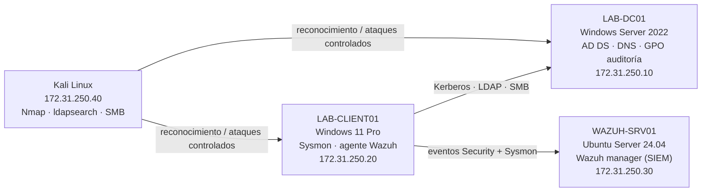

# Blue Team / SOC N1 — Portafolio

Profesional de **TI e infraestructura** (Windows Server, Active Directory, Linux, redes) en transición a **analista SOC / Blue Team**. Construí un laboratorio de detección propio, en el que ataco desde Kali y valido qué registra Windows, qué captura Sysmon y qué alerta Wazuh. Todo está documentado con evidencia.

**Regla de todo el repositorio:** separar lo **confirmado con evidencia** de lo hipotético o pendiente. No se publican datos productivos, credenciales ni IPs públicas.

> **English summary:** IT infrastructure professional transitioning to SOC Analyst (L1). Home detection lab (Active Directory + Sysmon + Wazuh SIEM + Kali). Documented investigations with evidence, MITRE ATT&CK mapping and detection logic. Content in Spanish.

---

## Casos SOC

| Caso | Qué demuestra |
|---|---|
| [**Triage de alertas Wazuh**](01-casos-soc/LAB-SOC-2026-004-triage-alertas-wazuh-falsos-positivos.md) | Clasificar alertas SIEM reconstruyendo la cadena padre-hijo: detección válida no es lo mismo que incidente |
| [**Fallo Kerberos invisible (4771)**](01-casos-soc/LAB-SOC-2026-003-fallo-kerberos-4771-brecha-visibilidad.md) | Detectar una brecha de auditoría que habría ocultado un password spraying, y corregirla por GPO |
| [**Escaneo SMB: LISTEN vs filtered**](01-casos-soc/LAB-SOC-2026-002-escaneo-smb-listen-vs-filtered.md) | Correlacionar Nmap ↔ endpoint ↔ firewall hasta probar el DROP en el log |
| [**Reconocimiento web en Apache**](01-casos-soc/SOC-001-reconocimiento-web-apache.md) | Análisis de 14.516 registros HTTP, falsos positivos y propuesta de detección |
| [**Fuerza bruta (TryHackMe)**](01-casos-soc/LAB-SOC-2026-001-fuerza-bruta-login-tryhackme.md) | Flujo N1 completo: triage, threat intel, contención, informe |

→ [Todos los casos](01-casos-soc/) · [Catálogo de detecciones](03-detecciones/)

---

## Laboratorio BLUELAB

Red host-only aislada (`172.31.250.0/24`) en VMware Workstation: sin NAT, sin bridge y sin salida a Internet.

**Ciclo de trabajo:** ataque controlado desde Kali → evidencia en el endpoint (Security / Sysmon / firewall) → ¿lo detectó Wazuh? → documentar la brecha o el ajuste → caso SOC.

→ [15 guías del laboratorio](02-laboratorio/)

---

## Competencias y dónde está la evidencia

| Competencia (SOC N1) | Evidencia |
|---|---|
| Triage de alertas en SIEM | [LAB-SOC-2026-004](01-casos-soc/LAB-SOC-2026-004-triage-alertas-wazuh-falsos-positivos.md) · [playbook de triage](03-detecciones/playbook-threat-hunting-triage-wazuh-sysmon.md) |
| Análisis de logs Windows | [4624/4625](02-laboratorio/07-logons-windows-4624-4625-correlacion.md) · [4771 Kerberos](01-casos-soc/LAB-SOC-2026-003-fallo-kerberos-4771-brecha-visibilidad.md) · [4768/4769](02-laboratorio/05-validacion-kerberos-klist-cifs-sysmon.md) |
| Sysmon (procesos y red) | [Guía Sysmon](02-laboratorio/04-sysmon-procesos-red-correlacion.md) · [config usada](03-detecciones/configuracion/sysmonconfig.xml) |
| Despliegue de SIEM | [Wazuh: manager + agente Windows + Sysmon](02-laboratorio/10-wazuh-siem-agente-windows-sysmon.md) |
| Correlación red ↔ endpoint | [LAB-SOC-2026-002](01-casos-soc/LAB-SOC-2026-002-escaneo-smb-listen-vs-filtered.md) |
| Logs web / HTTP | [SOC-001](01-casos-soc/SOC-001-reconocimiento-web-apache.md) |
| Active Directory y GPO | [Lab AD](02-laboratorio/01-bluelab-active-directory.md) · [GPO de auditoría para DC](02-laboratorio/08-gpo-auditoria-domain-controllers.md) |
| Reconocimiento de AD (vista del atacante) | [LDAP con cuenta estándar](02-laboratorio/12-reconocimiento-ad-ldap-cuenta-estandar.md) |
| MITRE ATT&CK | Mapeo en cada caso, solo con técnicas demostradas · [bases MITRE](06-formacion/fundamentos/bases-mitre-soc-n1.md) |
| Linux en producción | [Servidor web CentOS + cPanel](05-experiencia-infra/04-mantencion-servidor-web-linux-cpanel.md) · [Linux shell scripting](06-formacion/tryhackme/linux-shell-scripting-flag-hunt-laboratorio.md) |
| Respuesta a incidentes (NIST) | [Incident checklist](04-hardening/incident-checklist.md) · [assessment real anonimizado](05-experiencia-infra/01-assessment-seguridad-infraestructura.md) |

### Event IDs trabajados en el laboratorio

| ID | Significado | Dónde |
|---|---|---|
| 4624 | Inicio de sesión exitoso (LogonType 3, 5, 7) | [lab 06](02-laboratorio/06-autenticacion-4624-4771-gpo-dc.md) |
| 4625 | Inicio de sesión fallido (`0xC000006A` contraseña incorrecta) | [lab 03](02-laboratorio/03-auditoria-eventos-windows.md) · [lab 07](02-laboratorio/07-logons-windows-4624-4625-correlacion.md) |
| 4768 / 4769 | TGT / ticket de servicio Kerberos | [lab 05](02-laboratorio/05-validacion-kerberos-klist-cifs-sysmon.md) |
| 4771 | Fallo de preautenticación Kerberos (`0x18`) | [LAB-SOC-2026-003](01-casos-soc/LAB-SOC-2026-003-fallo-kerberos-4771-brecha-visibilidad.md) |
| 4688 | Creación de proceso (Security) | [lab 10](02-laboratorio/10-wazuh-siem-agente-windows-sysmon.md) |
| Sysmon 1 | Creación de proceso con línea de comandos y proceso padre | [lab 04](02-laboratorio/04-sysmon-procesos-red-correlacion.md) |
| Sysmon 3 | Conexión de red | [lab 04](02-laboratorio/04-sysmon-procesos-red-correlacion.md) |

---

## Experiencia real en infraestructura (anonimizada)

- [Assessment de seguridad: inventario verificado → matriz de riesgos → hardening](05-experiencia-infra/01-assessment-seguridad-infraestructura.md)
- [Migración de file server con modelo de mínimo privilegio y rollback](05-experiencia-infra/02-migracion-file-server-minimo-privilegio.md)
- [Acceso temporal de proveedor + simulación de incidente (4624+4672, WinRM, contención)](05-experiencia-infra/03-acceso-proveedor-y-simulacion-incidente.md)
- [Servidor web Linux (CentOS + cPanel): respaldos que parecían funcionar y no funcionaban](05-experiencia-infra/04-mantencion-servidor-web-linux-cpanel.md)

---

## Formación continua

[TryHackMe](06-formacion/tryhackme/) · [BTLO](06-formacion/btlo/) · [MITRE para SOC N1](06-formacion/fundamentos/bases-mitre-soc-n1.md) · [Bitácora de avance](BITACORA.md)

**Herramientas:** Wazuh · Sysmon · Windows Event Logs · Active Directory / GPO · Kerberos · PowerShell · Bash · Nmap · ldapsearch · DIRB · curl · VMware

---

*Todos los ejercicios ofensivos se realizaron en entornos propios aislados, en plataformas de práctica o con autorización explícita.*
